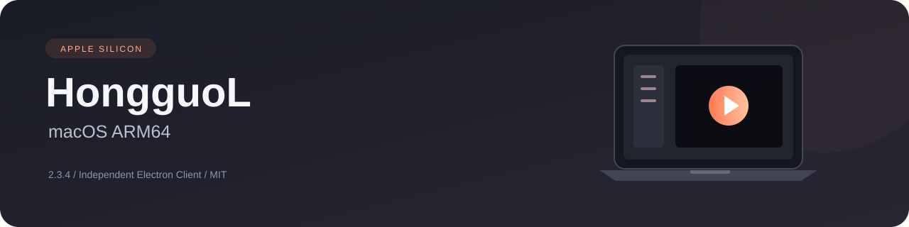

<div align="center">



**在 Mac 上，舒服地看短剧。**

独立 Electron 客户端 · Apple Silicon · macOS 13 及以上 · 源码版本 2.3.4

[下载 2.3.4](https://github.com/lhl1/hongguoL-macOS-ARM64/releases/tag/Hongguo-2.3.4-macOS-arm64) · [功能介绍](#可以做什么) · [开发历程](docs/DEVELOPMENT_HISTORY.md) · [问题排查](docs/TROUBLESHOOTING.md) · [MIT 许可](LICENSE)

</div>

---

## 这个项目是什么

HongguoL 是根据原 Android 应用的业务和接口重新编写的桌面客户端。界面、窗口、搜索、筛选和播放控制由本项目实现，内容仍向原服务请求。它是独立项目，与原应用及其运营方无隶属关系。

普通用户可以把它理解为：**把刷短剧、找剧和选集这些操作，重新做成适合电脑的样子。** 不是把官方网站装进窗口，也不是让你操作 Android 模拟器。少量 APK 原生组件通过本机 Java 适配器调用，没有 Android 系统界面。

本仓库是 **macOS ARM64 分支**。2.3.4 的界面和业务与 [Windows 分支](https://github.com/lhl1/hongguoL-desktop) 共用，Mac 播放沿用用户确认能正常播放的 `.13` 方案。本次面向 Apple Silicon，没有交付 Intel Mac 或 iPhone/iPad 版本。

> **先读这一点：** Git 源码树公开源码、文档和构建工具，不包含专有 APK 组件、SDK 配置或 JRE/FFmpeg 二进制。维护者另外在 Releases 发布完整安装 ZIP。普通用户下载安装包；开发者克隆源码并自行准备运行资源。只有 `git clone` 不能得到完整播放器。

## 可以做什么

| 场景 | 操作和效果 |
| --- | --- |
| 发现好剧 | 向下滚看下一部，向上回到之前的内容；一次滚动手势只切一次，双击“发现”刷新 |
| 搜索 | 输入时出现联想；结果继续加载；官方明确关联的系列剧放在一起 |
| 探索与筛选 | 按体裁、主题、设定、背景、推荐、受众、时间等条件找剧；选项和规则从服务取得 |
| 排行榜 | 使用原服务的排行类别、筛选和排序，不用搜索结果拼一个假榜单 |
| 先看简介 | 点击卡片先开小窗，了解剧情、集数和系列，选好再播放；设置里可改成直接播放 |
| 查看系列 | 在详情和选集中切换同系列作品；各作品分别保存观看进度 |
| 自由选集 | 点击 41，选中状态立即到 41；后台加载，快速点选以最后一次为准 |
| 播放控制 | 默认最高可用清晰度，可调清晰度、倍速、音量；支持进度跳转、自动下一集 |
| 干净的画面 | 留白纯黑，控制栏自动隐藏；沉浸状态切集时保持干净 |
| 目录排列 | 卡片与“一行一部剧”随时切换；可保存默认排列，默认仍是卡片 |
| 追剧与记录 | 卡片右键添加/取消追剧；本地保存收藏、观看进度，支持续播 |
| 设置与排查 | 亮色、暗色、跟随系统；设置中导出脱敏诊断日志 |

**“最高”指服务当前返回且可以播放的最高画质，不保证每部剧都有 1080P。** 预约剧会标明尚不能播放，锁定集数仍遵循原授权。接口、内容与服务可用性也可能变化。

<details>
<summary><strong>为什么选中状态立即变化，视频还要等一下？</strong></summary>

点击、网络请求和视频解码是三件事。新版先明确显示你选中了哪一集或分类，再等请求完成，避免让人以为没点上。只有真正播放的内容才写入记录，不把“点了但没播出来”当作已看。

翻动动画先开始，不等待下载。目标首帧没到时不误显示上一部，也不把动画冻在半途；收到目标帧后再呈现。跳转进度时保留当前视频帧，不回到封面。

</details>

## 界面怎样组织

```text
左侧导航                  中间内容                    需要时出现
发现 / 排行榜 / 探索      视频流或剧集目录            简介小窗
追剧 / 记录 / 设置        卡片 ↔ 一行一部剧           详情与选集
                          主题、筛选、系列信息        播放控制菜单
```

字体、圆角、图标和留白统一。筛选选项排不下就换行；小窗加载前后保持同一尺寸；清晰度、倍速和设置菜单用应用自己的样式。大量内容滚动显示，不用突然伸缩的弹窗挤动页面。

顶部图片是项目原创示意图，**不是 Mac 实机截图**。用户截图、账号界面和真实网络响应没有作为文档素材上传。

## 怎样开始

### 只想安装使用

从 [2.3.4 发布页](https://github.com/lhl1/hongguoL-macOS-ARM64/releases/tag/Hongguo-2.3.4-macOS-arm64) 下载 `Hongguo-2.3.4-macOS-arm64.zip`，然后：

1. 解压到新目录，手动退出旧红果。
2. 在解压目录运行 `sh 准备Mac版.command`。
3. 等待文件校验、签名检查和后台视频自检。
4. 成功后打开 `~/Applications/Hongguo.app`。

已有安装先备份，自检失败不替换旧版。不要直接打开 Downloads 里的源应用，也不要为了运行它关闭全局系统安全检查。详细步骤和写入位置见[安装说明](docs/INSTALL_MACOS.md)。

安装包约 242 MB，保留整个解压目录。历史可播放基线见 [.13 发布页](https://github.com/lhl1/hongguoL-macOS-ARM64/releases/tag/Hongguo-0.6.0.13-macOS-arm64)。完整成品含第三方运行组件，MIT 只覆盖项目原创部分；下载包与 GitHub 自动生成的 Source code 压缩包用途不同。

### 想阅读或修改源码

准备 Git 和 Node.js 24：

```bash
git clone https://github.com/lhl1/hongguoL-macOS-ARM64.git
cd hongguoL-macOS-ARM64
npm ci
npm run build
npm test
```

这一步不需要登录，不发短信，不需要原 APK。`build` 检查代码并生成界面；`test` 使用合成数据。其他主机也能检查源码，应用交互启动只面向 macOS ARM64。

要运行或构建完整本地包，需要 Python 3.11+ 和自行持有的已验证 `.13` ARM64 基线 ZIP：

```bash
# 在 Apple Silicon Mac 上准备开发运行资源
npm run prepare:mac -- --baseline "/你的路径/原始-.13-macOS-arm64.zip"
npm start

# 重新构建本地 Mac ZIP，Windows 也可交叉组包
npm run pack:mac -- --baseline "/你的路径/原始-.13-macOS-arm64.zip"
```

脚本校验基线 SHA256，直接保留原生组件与 FFmpeg 供应商签名，用新源码更新应用。输出为 `release-macos-2.3.4-arm64/`；已存在时拒绝覆盖，先备份移开。**基线不在 Git 源码树，可从 .13 发布页自行下载；脚本只读取本地 ZIP。** Java 重建方法、依赖和签名流程见[构建说明](docs/BUILD_MACOS.md)。

## Mac 播放为什么单独处理

Windows 能播，不代表相同网络读取和系统信任流程在 Mac 也能工作。早期 Mac 有两个独立问题：准备应用时被系统拒绝，以及应用打开后视频源打不开。后者不能靠换按钮或反复重新加载解决。


Electron 读取远端视频，FFmpeg 解码，两者通过受限制的本机地址连接。保留清晰度、跳转和原授权，同时避免解码器独自走另一条 HTTPS 路径。每次重定向检查来源，不关闭证书验证，真实播放地址和密钥不交给页面或写进日志。

安装保留解码器供应商签名，对更新的应用部分分层签名，再做首帧自检。调查、修复和验证过程见[开发历程](docs/DEVELOPMENT_HISTORY.md)。

## 权限、数据与登录

| 项目 | 实际行为 |
| --- | --- |
| 管理员密码 | 普通运行和准备不需要管理员权限，不执行 `sudo` |
| 游客身份 | 按服务响应创建，只在 Mac 当前进程内存保存；退出后不落盘 |
| 钥匙串 | 游客启动不读取；主动实验登录保存加密账号时可能出现 macOS 授权提示 |
| 收藏和记录 | 保存在本机应用目录，升级不主动删除 |
| 系统设置 | 不改全局代理、证书、Gatekeeper/SIP、主题、PATH 或启动项 |
| 签名准备 | 只处理新建副本内的下载隔离属性和签名，不处理其他软件 |
| 云同步 | 仍有兼容性限制；本地记录不能当作原账号同步成功 |

系统密码由 macOS 接收，应用不收集。钥匙串提示不是管理员提权。排查优先使用设置导出的脱敏日志；不要公开手机号、验证码、Cookie、播放地址或密钥。详见[安全文档](SECURITY.md)。

## 已验证到什么程度

| 证据 | 结论 |
| --- | --- |
| `.13` Mac 基线 | 用户明确反馈可以正常播放 |
| 本地 2.3.4 成品 | 87 项测试通过；Windows 主机启用共用 Mac 媒体路径，在线播放、进度、系列、筛选与布局回归通过 |
| 包完整性 | ARM64、权限、链接和校验清单通过；FFmpeg 与全部原生资源字节保留 |
| 公开源码 | 无私有资源也可构建并做离线测试；可选 HEIC 测试缺少本地样本/资源时跳过 |
| 2.3.4 Mac 实机 | 本次构建主机没有 Mac，不把跨平台测试写成实机成功；安装前由本机脚本自检 |
| 短信登录/云同步 | 本批次没有真实账号验收；相关测试只验证合成响应 |

GitHub Actions 配置只做源码构建与离线检查，不携带私有资源、不发短信，不据此宣称真实播放已验证。更多说明见[验证范围](docs/VERIFICATION.md)。

## 文件导航

| 位置 | 通俗说明 |
| --- | --- |
| `src/` | 你看到的界面：发现、目录、播放器、详情、设置 |
| `electron/` | 后台：窗口、接口、视频、记录与日志 |
| `native-adapter/` | 本项目编写的 Java 原生连接层 |
| `scripts/` | 本地基线准备、组包、安装与诊断 |
| `tests/` | 合成响应、边界、状态变化和错误处理 |
| `docs/` | 构建、安装、排查、架构、验证与开发历程 |

推荐顺序：**[安装](docs/INSTALL_MACOS.md) → [排查](docs/TROUBLESHOOTING.md) → [开发历程](docs/DEVELOPMENT_HISTORY.md) → [架构](docs/ARCHITECTURE.md)**。修改前请读[贡献说明](CONTRIBUTING.md)。

## 许可与公开范围

原创源码、文档、测试和矢量标识采用 [MIT License](LICENSE)。MIT 不覆盖原 APK、专有库/SDK、官方品牌、影视内容及第三方组件。

Git 源码树没有预置他人账号、设备身份、播放密钥或捕获响应；不包含原 APK、官方图标、第三方二进制、用户截图、日志或完整安装 ZIP。Releases 中的成品另行发布，内含运行组件，分别遵循原条款，见[第三方说明](THIRD_PARTY_NOTICES.md)。维护时应更新真实契约和测试，保留预约及锁定状态，不伪造数据代替失败响应。
